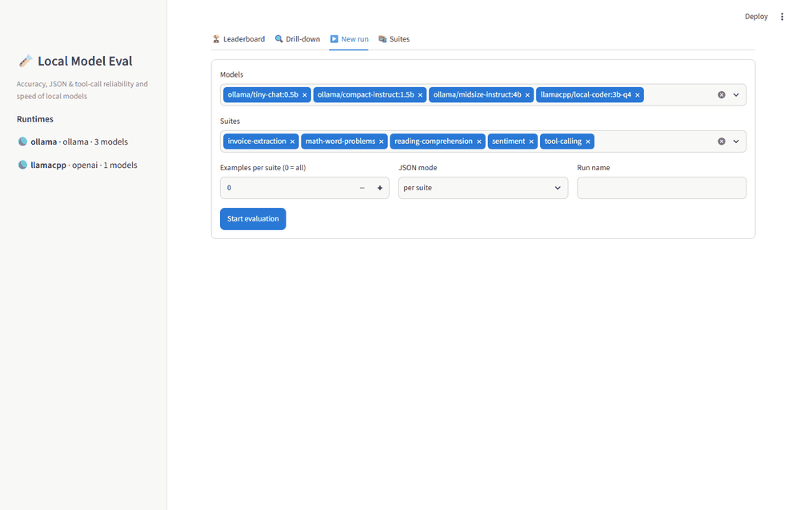
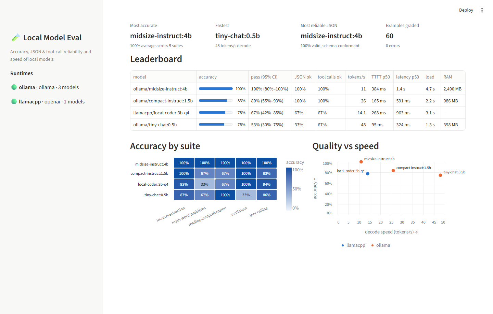
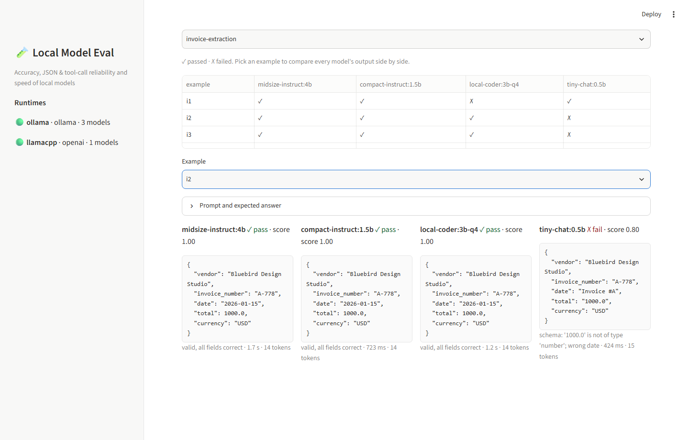
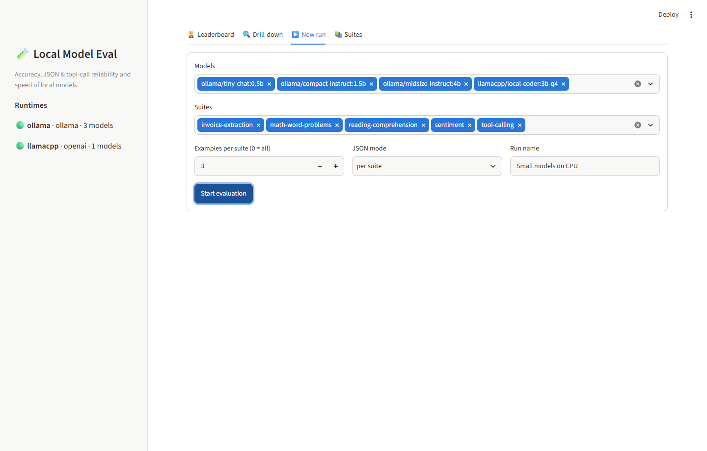

# Local Model Eval Harness

[](https://github.com/yordanossimegnew/local-model-eval-harness/actions/workflows/tests.yml)

Which local model should you actually run? This harness puts models served by **Ollama** or any
**OpenAI-compatible server** (llama.cpp, vLLM, LM Studio, LocalAI) through the same eval suites.
For each model it measures **task accuracy**, **JSON and tool-call reliability**, and **speed and
resources**:
- time to first token;
- decode tokens/s;
- latency;
- load time;
- RAM.

The results become a leaderboard you can drill into, down to every single output.

Built with **LangGraph** (one graph per run, with a resumable per-model fan-out) and **LangChain**
(`ChatOllama` and `ChatOpenAI`, so both runtime types share one code path, including tool calling),
on **PostgreSQL**, with a **FastAPI** API, a CLI and a **Streamlit** UI.



<sub>Demo runs against scripted stand-in servers that speak the real Ollama and OpenAI-compatible APIs; the model names and their scores are fictional. Run it against your own models for real numbers.</sub>

| Leaderboard | Drill-down | New run |
|---|---|---|
|  |  |  |

## What it measures

| | How |
|---|---|
| **Accuracy** | Every example gets a 0–1 score from a deterministic grader: `exact`, `choice`, `contains`, `regex`, `number` (the last number in a worked answer), `json` (field-level partial credit) or `tool_call` (right tool, then right arguments). The leaderboard averages suites equally, and pass rates come with a 95% Wilson interval, because 10 examples prove less than they seem to. |
| **JSON reliability** | Valid only if the whole reply (a ```` ```json ```` fence is tolerated) parses and matches the suite's JSON Schema. JSON wrapped in chatter ("Sure! Here is…") still gets field credit but counts as **invalid**, because a parser in production would choke on it. `json_mode` lets you compare raw output with constrained decoding (Ollama `format=json`, OpenAI `response_format`). |
| **Tool-call reliability** | Valid when the model calls a tool that exists, with arguments that validate against that tool's schema (`"amount": "two hundred"` fails). Examples that need no tool check the model *doesn't* call one. |
| **Speed** | Every request is streamed. **TTFT** is the time to the first token. **Decode tokens/s** comes from Ollama's own `eval_count / eval_duration`, or from tokens after the first one for OpenAI-compatible servers. Latency is reported as p50/p95. **Load time** is measured by a warm-up request before each model's examples. |
| **Resources** | Model memory and the GPU-offload share from Ollama's `/api/ps`, plus host CPU and RAM sampled during each model's run (meaningful when the runtime runs on the same machine). |

Models run **one at a time**: two models sharing a CPU or GPU would make every speed number wrong.
Every result is stored as soon as it's graded, so an interrupted run **resumes** where it
stopped, and finished models aren't reloaded.

## Built-in suites

| Suite | Grader | What it tests |
|---|---|---|
| `sentiment` | choice | 12 reviews: positive / negative / neutral, including sarcasm and mixed reviews |
| `math-word-problems` | number | 10 multi-step arithmetic problems |
| `reading-comprehension` | contains | 8 questions answerable only from a passage |
| `invoice-extraction` | json + schema | 8 messy invoices (dates like `21.04.2026`, `1'380.00`, mixed currencies) → strict JSON |
| `tool-calling` | tool_call | 10 requests across 3 tools, including 2 that need no tool |

### Add your own

```
suites/my-suite/
├── suite.yaml        # prompt template with {{variables}}, grader, params, tools
└── examples.jsonl    # {"id": "...", "<variable>": "...", "expected": ...} per line
```

```yaml
description: Route support emails to a team.
category: accuracy          # accuracy | json | tools
system: You route support emails.
template: |
  Which team should handle this email: billing, technical or sales? One word.

  {{email}}
grader: {type: choice, choices: [billing, technical, sales]}
params: {temperature: 0, max_tokens: 10}
```

`python main.py suites` validates every suite. It checks for unique ids, that each example has an
`expected` value and every template variable, and that each line is valid JSONL.

## Project structure

```
local-model-eval-harness/
├── README.md
├── requirements.txt
├── .env.example            # copy to .env (never commit .env)
├── .gitignore
├── Dockerfile
├── docker-compose.yml      # Postgres + API + UI (Ollama stays on the host)
├── runtimes.yaml           # your Ollama / OpenAI-compatible servers
├── main.py                 # FastAPI app (`main:app`) + CLI: models / suites / run / report / serve
├── suites/                 # eval suites (YAML header + JSONL examples)
├── ui/app.py               # Streamlit: leaderboard, drill-down, new run, suites
├── docs/                   # demo.gif + screenshots
├── src/
│   ├── agent/
│   │   ├── agent.py        # LangGraph: plan -> Send x model -> eval_model -> summarize
│   │   ├── report.py       # leaderboard: accuracy, CIs, reliability, speed percentiles
│   │   ├── resources.py    # host CPU/RAM sampler
│   │   ├── factory.py      # wires Postgres, runtimes, checkpointer
│   │   └── memory.py       # Postgres checkpointer
│   ├── models/runtimes.py  # ChatOllama / ChatOpenAI, streaming timing, /api/tags, /v1/models, /api/ps
│   ├── tools/
│   │   ├── suites.py       # suite specs (Pydantic), loading and validation
│   │   ├── graders.py      # deterministic graders, JSON and tool-call validity
│   │   ├── stats.py        # Wilson interval, percentiles
│   │   └── store.py        # Postgres: runs, results, per-model stats
│   ├── prompts/            # (prompts live in each suite)
│   ├── utils/              # config (env/.env), logging
│   └── api/routes.py       # FastAPI routes
└── tests/
    ├── fake_runtime.py     # scripted server speaking the Ollama + OpenAI wire protocols
    └── ...                 # graders, suites, full runs, resume, API, CLI
```

## Setup

```bash
cd local-model-eval-harness
python -m venv .venv
# Windows: .venv\Scripts\activate   |   macOS/Linux: source .venv/bin/activate
pip install -r requirements.txt
cp .env.example .env
```

```sql
CREATE DATABASE local_model_eval;
CREATE DATABASE local_model_eval_test;   -- pytest only
```

Start a runtime and pull a few models:

```bash
ollama serve
ollama pull qwen2.5:1.5b
ollama pull llama3.2:1b
```

To use a different server, edit `runtimes.yaml`; any OpenAI-compatible `/v1` endpoint works.

## Use it

```bash
python main.py models                                     # what each runtime serves
python main.py run ollama/qwen2.5:1.5b ollama/llama3.2:1b --limit 5
python main.py run ollama/qwen2.5:1.5b --suite invoice-extraction --json-mode on
python main.py report <run_id>
uvicorn main:app --reload                                 # API -> http://localhost:8000/docs
streamlit run ui/app.py                                   # UI  -> http://localhost:8501
```

```
model                              acc  pass  json tools   tok/s      TTFT       p50      load
----------------------------------------------------------------------------------------------
ollama/midsize-instruct:4b        100%  100%  100%  100%    11.0   384.0ms  1,400.0ms 4,800.0ms
ollama/compact-instruct:1.5b       83%   80%  100%  100%    26.0   164.0ms    590.0ms 2,300.0ms
```

## API

| Method | Path | Description |
|---|---|---|
| GET | `/runtimes` | Each runtime: online or offline, and its models (`<runtime>/<model>` refs) |
| GET | `/suites`, `/suites/{name}` | Suites and their examples |
| POST | `/runs` | `{"models": [...], "suites": [...], "limit": 5, "json_mode": null}`; runs in the background |
| GET | `/runs`, `/runs/{id}` | Runs with live progress and, when done, the leaderboard |
| POST | `/runs/{id}/resume` | Continue an interrupted run (finished results are kept) |
| GET | `/runs/{id}/results` | Every output with its grade, filterable by model and suite |
| GET | `/leaderboard` | The latest completed run's leaderboard |

## Tests

```bash
pytest -q
```

The tests run a scripted server that speaks the real Ollama (NDJSON streaming, `eval_count`,
`/api/ps`) and OpenAI (SSE streaming, usage chunk, streamed tool-call arguments) protocols, so
`ChatOllama` and `ChatOpenAI` run unmodified. They cover:
- every grader;
- suite validation;
- full runs on Postgres;
- exact decode speed;
- unavailable models and offline runtimes being reported instead of crashing the run;
- crash and resume without re-running finished work;
- `json_mode` passthrough;
- the API and the CLI.

## Ideas to extend

- An optional LLM judge for open-ended answers.
- Repeat runs at temperature > 0 to measure consistency.
- Compare quantizations of one model (Q4 vs Q8) side by side.
